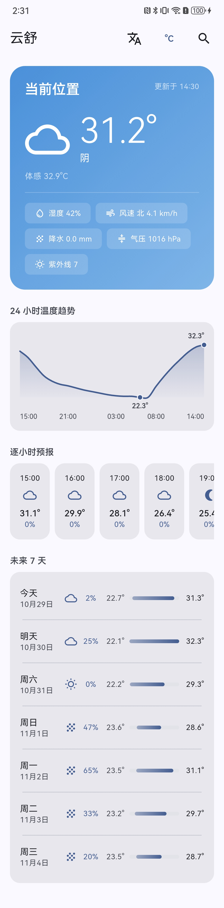
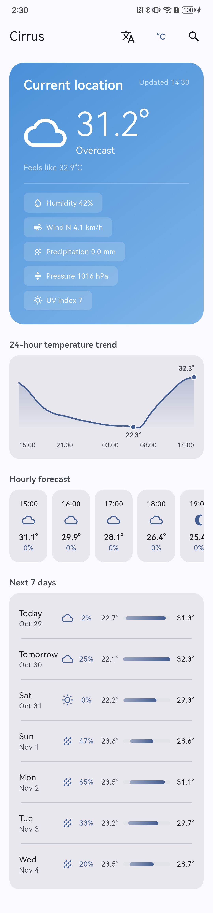
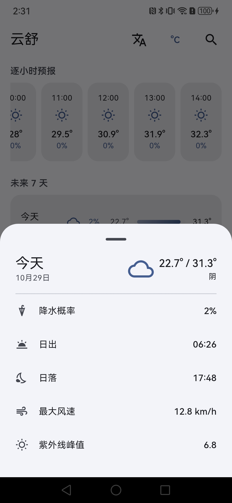

# Weather App（Flutter）

一个跨平台移动端天气应用：搜索地点（支持中文与英文）、使用当前位置、查看当前天气与未来 7 天预报、查看单日详情，并完整处理加载态 / 错误态 / 空态。

数据来自 [Open-Meteo](https://open-meteo.com/)（天气与拉丁字母地理编码）+ [Photon](https://photon.komoot.io/)（中日韩文字地理编码与坐标反查），均无需 API Key，克隆后可直接运行。

---

## 预览

| 首页（简体中文） | 首页（English） |
|---|---|
|  |  |

| 当日详情 | 搜索与最近记录 |
|---|---|
|  |  |

---

## 1. 功能

| 能力 | 说明 |
|------|------|
| 地点搜索 | 300ms 防抖 → 候选列表（名称 / 行政区 / 国家消歧）→ 选择；**中文关键词可用** |
| 中文搜索兜底 | 按关键词是否含 CJK 自动切换首选数据源，另一源兜底 |
| 中文译名搜索 | 「纽约」「伦敦」「旧金山」等 40+ 个外来地名可通过别名表命中本地城市 |
| 使用当前位置 | 一键定位 → 坐标反查城市名 → 加载天气；拒绝授权 / 定位关闭 / 超时均有降级路径 |
| 当前天气 | 温度、天气现象与图标、体感温度、湿度、风速风向、气压、降水、紫外线 |
| 逐小时预报 | 从当前小时起 24 小时，横向滚动 |
| 温度趋势图 | 24 小时曲线自绘（不引入图表库），横向滑动 / 轻点选中小时点，标签随系统字号缩放 |
| 多日预报 | 未来 7 天，天气图标、降水概率、温度区间条形图 |
| 当日详情 | 点击某一天弹出面板：降水概率、日出 / 日落、最大风速、紫外线峰值；缺失字段整行隐藏 |
| 加载态 | 骨架屏（延迟 200ms 展示，避免闪烁）；刷新时保留内容 + 局部指示器 |
| 错误态 | 分类文案 + 可重试性判断 + 重试按钮；刷新失败用 SnackBar，不打断已展示内容 |
| 空态 / 无结果态 | 与错误态严格区分：无结果不给「重试」按钮 |
| 最近搜索 | 本地持久化，最多 5 条，可删除 |
| 单位切换 | °C / °F，持久化；缓存键包含单位，避免切换后显示旧单位数据 |
| 语言 | 简体 / 繁體 / English，跟随系统或手动选择；桌面显示名随系统语言本地化（云舒 / 雲舒 / Cirrus） |
| 主题 | Material 3，跟随系统亮 / 暗色 |

---

## 2. 技术栈

| 领域 | 选择 | 版本 |
|------|------|------|
| SDK | Flutter（fvm 管理） | 3.47.8 / Dart 3.13.7 |
| 状态管理 + DI | flutter_riverpod | ^3.4.3 |
| HTTP | dio | ^5.11.1 |
| 路由 | go_router | ^18.1.1 |
| 本地存储 | shared_preferences | ^2.5.6 |
| 定位 | geolocator | ^14.1.2 |
| 本地化 | flutter_localizations（SDK） | — |
| 静态检查 | flutter_lints + 自定义规则 | ^6.0.0 |

运行时第三方依赖只有 5 个，`pub get` 后无需任何代码生成步骤。

---

## 3. 快速开始

```bash
# 1. 使用 fvm（项目已包含 .fvmrc）
fvm install
fvm flutter pub get

# 2. 运行（无需申请任何 API Key）
fvm flutter run

# 3. 质量检查
fvm flutter analyze
fvm flutter test
fvm dart format --output=none --set-exit-if-changed lib test
```

环境要求：Flutter 3.47+（Dart 3.13+）、iOS 15+ / Android 7.0+（minSdk 24）。

**平台权限声明**（已配置）：

- Android：`INTERNET`、`ACCESS_COARSE_LOCATION`、`ACCESS_FINE_LOCATION`
- iOS：`NSLocationWhenInUseUsageDescription`

所有请求均为 HTTPS，无需额外配置 Android 明文流量或 iOS ATS 例外。定位是**可选能力**：拒绝授权后应用仍可通过搜索完整使用。

**桌面显示名**跟随系统语言（与应用内语言设置相互独立）：简体中文「云舒」、繁体中文「雲舒」、其他语言「Cirrus」。Android 通过 `values-zh-rCN` / `values-zh-rTW` / `values-b+zh+Hans` / `values-b+zh+Hant` 等资源限定符实现，iOS 通过 `InfoPlist.strings` 覆盖 `CFBundleDisplayName`。

**应用图标**：母版为 `design/yunshu-app-icon-1k.png`，各平台尺寸由脚本生成：

```bash
swift tool/generate_app_icons.swift design/yunshu-app-icon-1k.png .
```

脚本会抠出母版的云形图层并合成到纯色底上，随后产出 iOS 全套尺寸、Android 自适应图标（`mipmap-anydpi-v26`）与低版本传统图标（`mipmap-*dpi`）。

---

## 4. 项目结构

```
lib/
├── main.dart                     # 入口：初始化 SharedPreferences 并注入 ProviderScope
├── app/
│   ├── app.dart                  # MaterialApp.router + 主题 + 本地化
│   └── router.dart               # go_router 路由表
├── core/                         # 跨 feature 的基础设施
│   ├── config/app_config.dart    # 超时、防抖、天数、缓存时长、API 端点（唯一修改点）
│   ├── domain/location.dart      # 共享内核实体 Location + UnitSystem
│   ├── error/                    # Failure 类型树 + 错误映射
│   ├── network/dio_client.dart   # Dio 装配 + 重试拦截器
│   ├── providers/                # Dio / SharedPreferences 等全局 Provider
│   ├── state/                    # 跨 feature 状态：选中地点、单位制
│   ├── storage/                  # PreferencesStore 门面
│   ├── theme/                    # 主题与设计 token
│   ├── utils/                    # 日期格式化、WMO 代码映射、取消令牌
│   ├── widgets/                  # 共享组件：骨架屏 / 错误态 / 空态 / 区块标题 / 语言菜单
│   └── l10n/app_strings.dart     # 文案集中处（简 / 繁 / 英）
└── features/
    ├── search/                   # 「怎么找到并选中一个地点」
    │   ├── data/
    │   │   ├── datasource/       # Open-Meteo / Photon / 组合数据源 / geolocator 实现
    │   │   ├── dto/              # LocationDto（公共传输形态）、PhotonFeatureDto
    │   │   ├── aliases/          # 中文译名 → 本地正式名 + 国家码
    │   │   └── repository/
    │   ├── domain/               # Repository 接口、ReverseGeocoder、LocationService、UseCase
    │   └── presentation/         # 搜索状态机 / Provider / 搜索面板 / 定位按钮
    └── weather/                  # 「拿到天气并展示」
        ├── data/                 # DTO / Mapper / DataSource / Repository / 内存缓存
        ├── domain/               # Entity / Repository 接口 / UseCase
        └── presentation/         # 状态机 / Provider / 首页 / 天气组件 / 当日详情面板

test/                             # 镜像 lib/ 结构
```

---

## 5. 架构

### 5.1 分层与依赖方向

```
Presentation (Widget / Provider)
      ↓
Application (Notifier 状态机)
      ↓
Domain (Entity / Repository 接口 / UseCase)   ← 纯 Dart，零 Flutter / Dio / geolocator 依赖
      ↑
Data (DataSource / DTO / Mapper / Repository 实现)
      ↓
Open-Meteo / Photon / geolocator
```

约束：

- 依赖只能自上而下，`data` 通过**依赖倒置**实现 `domain` 定义的接口；
- `domain/` 目录内不出现 `package:flutter`、`package:dio`、`package:geolocator`、JSON 注解；
- 跨 feature 复用的东西下沉到 `core/`，两个 feature 之间不互相 import domain。

保留 Repository 抽象是为了给出**明确的替换路径**：换天气供应商只需新增 `data/` 下的实现 + 改一处 Provider 装配，`domain` 与 `presentation` 零改动。`WeatherRepository` 的方法签名里没有任何 Dio / HTTP 概念——连取消令牌都是自定义的 `RequestToken`。

UseCase 只保留真正承载领域规则的两个：

- `GetWeatherUseCase`：**没有任何逐日预报的响应视为数据不完整**，直接判定解析失败，避免渲染出一个空列表的"成功"页面；
- `ResolveCurrentLocationUseCase`：定位失败向上抛；定位成功但反查地名失败**不当作错误**，用「当前位置」兜底——天气只需要经纬度。

### 5.2 地理编码：双源组合

Open-Meteo 的地理编码索引以拉丁字母为主，输入「台北」返回空数组，输入 `Taipei` 才有结果。因此不是简单的"主备切换"，而是**按关键词语言选择首选源**：

```
query 含 CJK ?
├─ 是 → Photon（首选）→ 空/失败 → Open-Meteo（兜底）
└─ 否 → Open-Meteo（首选）→ 空/失败 → Photon（兜底）
```

正常情况下只发一次请求；只有命名习惯不匹配时才多一次往返。

| 查询 | 命中源 | 首条结果 |
|------|--------|---------|
| 台北 | Photon | 臺北市 / 臺灣 |
| 上海 | Photon | 上海市 / 中国 |
| 京都 | Photon | 京都市 / 京都府 / 日本 |
| Taipei | Open-Meteo | 台北市 / 台湾 |
| Springfield | Open-Meteo | 斯普林菲尔德 / 密苏里州 / 美国 |

Photon 的结果是 OSM POI，原始顺序会把「台北车站」排在「臺北市」前面，因此 DataSource 内按**地点类型权重**（city/state > county > district > locality > street > house）做稳定排序，再截断到 10 条。

两种响应结构在 Data 层**归一化为同一个 `LocationDto`**，Repository 与上层完全不需要知道命中了哪个供应商。

两个 geocoder 都按「本地名称」建索引，「纽约」这类中文译名并不在索引里（实测只会命中同名的餐厅或返回空）。因此对**译名与本地名不同形**的城市，用一张有边界的别名表（`data/aliases/cjk_city_alias.dart`，约 48 条）桥接到本地正式名 + 国家码；表外查询仍走上面的双源流程。上海、北京这类本身就能命中的城市不收录，避免把显示名变成外语。

### 5.3 定位：平台能力被关在接口后面

```
UseCurrentLocationButton (UI)
      ↓
CurrentLocationNotifier  ── 只暴露 state: 是否正在定位
      ↓
ResolveCurrentLocationUseCase
      ↓                        ↓
LocationService (接口)     ReverseGeocoder (接口)
      ↓                        ↓
GeolocatorLocationService  Photon /reverse
```

抽象出 `LocationService` 的收益是：整条「定位 → 反查 → 选中 → 加载天气」链路可以**在没有真机、不弹权限框的情况下被单测覆盖**。

平台异常在 `GeolocatorLocationService` 内被翻译成领域 `Failure`：

| 情况 | Failure | 用户可见行为 |
|------|---------|-------------|
| 用户拒绝授权 | `LocationPermissionFailure` | SnackBar「可手动搜索城市」，不阻塞 |
| 永久拒绝 | `LocationPermissionFailure(permanentlyDenied: true)` | SnackBar 提示去系统设置开启 |
| 系统定位关闭 / 硬件不可用 / 超时 | `LocationUnavailableFailure` | SnackBar「暂时无法获取当前位置」 |
| 反查地名失败 | 不报错 | 正常选中「当前位置」，天气照常加载 |

### 5.4 逆地理编码：层级选择

OSM 的行政层级字段命名并不规整，同一个字段在不同地区含义不同：

| 位置 | `state` | `city` | `district` | 说明 |
|------|---------|--------|-----------|------|
| 深圳 | 广东省 | 深圳市 | 福田街道 | 规整：省 / 市 / 街道 |
| 杭州 | 浙江省 | 杭州市 | 湖滨街道 | 同上 |
| 台北 | — | 臺北市 | 中山區 | 无省，市 / 区 |
| 纽约 | New York | — | — | 无 city，靠 state 兜底 |
| 上海 | 上海市 | 黄浦区 | 南京东路街道 | **不规整**：区的层级被标成 city |

因此按用途分别选层级：

- **主名**：`city → county → state → name`，越具体越好；
- **副名**：`district → locality`，区/街道比省更有信息量；
- **搜索列表**：用 `state → city → county` 做消歧（区分同名城市需要州/省级信息）。

实际效果：

```
台北 -> 臺北市 / 中山區 · 臺灣
深圳 -> 深圳市 / 福田街道 · 中国
北京 -> 北京市 / 东城区 · 中国
上海 -> 黄浦区 / 南京东路街道 · 中国   ← 直辖市特例，见已知限制
东京 -> 東京都 / 新宿区 · 日本
纽约 -> New York / United States
杭州 -> 杭州市 / 湖滨街道 · 中国
```

---

## 6. 状态管理

用 **Riverpod 3**，状态用 **sealed class 显式状态机**表达：

```dart
sealed class WeatherState {}
final class WeatherInitial extends WeatherState {}          // 空态
final class WeatherLoading extends WeatherState {}          // 骨架屏
final class WeatherSuccess extends WeatherState { Weather weather; }
final class WeatherError   extends WeatherState { Failure failure; }
```

不用 `isLoading / hasError / data` 三个布尔+字段，是因为它们允许出现「同时 loading 和 error」这类非法组合；sealed class 在编译期就没有这种可能，同时让 `switch` 渲染具备穷尽性检查。

搜索侧同理：`SearchIdle / SearchTooShort / SearchLoading / SearchResults / SearchEmpty / SearchError` 六个状态互斥，其中 `SearchEmpty`（没搜到）与 `SearchError`（调用失败）分开，正是"不给无结果场景展示重试按钮"的实现基础。

**响应式数据流**：`selectedLocationProvider` 或 `unitSystemProvider` 变化 → `weatherProvider` 自动重建 → 重新加载。Widget 里没有任何"手动触发请求"的代码：

```
selectedLocationProvider ─┐
unitSystemProvider ───────┼→ weatherProvider → WeatherState → switch 渲染
getWeatherUseCaseProvider ┘
```

「使用当前位置」也只做一件事：把结果写进 `selectedLocationProvider`，天气数据自动跟上来。

**缓存**：`WeatherMemoryCache`，键为 `(纬度, 经度, 单位制)`，新鲜度 10 分钟。把单位放进键里是有意为之——否则切换 °C/°F 后会命中旧单位的数据。

---

## 7. 错误处理

一条链路，一个出口：

```
DioException / FormatException / SocketException / geolocator 异常
        ↓  映射（core/error/error_mapper.dart + GeolocatorLocationService）
Failure（Network / Timeout / Server / RateLimit / Client / NotFound / Parse / Cancelled /
         LocationPermission / LocationUnavailable / Unknown）
        ↓  每个子类自带 displayMessage + canRetry（是否可重试）
State = WeatherError(failure)
        ↓
ErrorView（文案 + 按 canRetry 决定是否展示重试按钮）
```

- **UI 层不出现任何第三方异常类型**：没有 `on DioException`、也没有 `on PermissionDeniedException` 分支，只有 `if (failure.canRetry)`。
- **重试策略集中在网络层**（`RetryInterceptor`）：网络/超时最多 2 次、5xx 最多 3 次、429 遵循 `Retry-After`、其余 4xx 不重试。
- **取消不当错误**：修改搜索词会 cancel 上一请求，`CancelledFailure` 不展示提示，也不触发备用数据源。
- **刷新失败不毁掉页面**：下拉刷新失败只弹 SnackBar，保留已渲染内容。

---

## 8. 设计取舍

| 决策 | 选择 | 否决的替代方案 | 理由 | 代价 |
|------|------|---------------|------|------|
| 天气 API | Open-Meteo | OpenWeatherMap / WeatherAPI | **免 API Key**，克隆即跑；一次请求返回 current+hourly+daily+时区 | 天气图标需自行把 WMO code 映射为图标 |
| CJK 搜索 | Photon 兜底 + 双源组合 | 换掉 Open-Meteo / 本地地名映射表 | 换天气源成本高；本地映射表覆盖有限、维护成本高。组合方案把「中文能不能搜到」从缺陷变成可选路径 | 多一个外部依赖与一套 DTO 归一化 |
| 首选源策略 | 按 CJK 字符切换，而非固定主备 | 永远先 Open-Meteo 再 Photon | 固定主备会让**每一次**中文查询都多一次空往返（约 400ms） | 需要维护 CJK 正则；混合语言查询可能走错首选源（但仍有兜底） |
| 逆地理编码层级 | 主名取城市级、副名取区/街道 | 主名取省级（`state` 优先） | 天气按城市感知，省级名字没有信息量 | 直辖市因 OSM 标注不规整会显示区级主名 |
| Photon 结果排序 | 按 OSM 地点类型加权排序 | 直接采用 Photon 原始顺序 | 原始顺序把「台北车站」这类 POI 排在城市前面 | 乡村/POI 类查询可能被行政级别结果挤到后面 |
| 定位 | geolocator + `LocationService` 抽象 | 直接在 Widget 里调 `Geolocator` | 权限、拒绝分支、超时是大量边界；抽象后整条链路可单测，换库不影响上层 | 多一层接口与一个适配器 |
| 定位精度 | `LocationAccuracy.low` + 12s 超时 | `best` | 天气只需城市级精度，低精度更快、更省电、更少权限摩擦 | 极端情况下坐标可能落在相邻行政区 |
| 权限拒绝提示 | SnackBar 轻提示 | 完全静默 | 点按钮完全没反应是更差的体验；SnackBar 非阻塞 | 多一处提示文案 |
| 当日详情载体 | BottomSheet | 独立路由页 | 单日详情内容量小，跳页会丢失返回上下文 | 屏幕空间有限，内容变多需改页面 |
| 状态管理 | Riverpod 3 | setState / Provider / Bloc / GetX | 编译期安全、不依赖 BuildContext 易测；依赖变化自动重建，天然实现「换城市/换单位即重新加载」 | 需理解 Provider 作用域与惰性语义 |
| 状态建模 | sealed class 状态机 | 多个 bool + nullable 数据字段 | 编译期消除非法状态组合，switch 穷尽检查 | 每个状态多一个类 |
| 代码生成 | **不使用** freezed / json_serializable | freezed + build_runner | 少一个构建步骤，`pub get` 后可直接运行 | 手写 `fromJson` 与 `==`/`hashCode` |
| 架构深度 | 轻量 Clean（4 层，UseCase 按需） | 完整 Clean / 完全不分层 | 完整 Clean 对该规模是过度设计；不分层则无法展示边界 | 分层判断需要人工纪律 |
| 网络库 | Dio | http | 需要 `CancelToken`（搜索防抖取消）与拦截器（统一重试/错误映射） | 依赖体积略大，需封装避免泄漏到 domain |
| 取消原语 | 自定义 `RequestToken` | 直接用 Dio `CancelToken` | 保持 domain 纯 Dart | 多一个桥接类 |
| 缓存 | 内存缓存 + 10 分钟新鲜度 | 无缓存 / Hive/Isar 持久化 | 天气时效性短，持久化收益低于引入数据库的成本 | 冷启动必然请求一次 |
| 页面结构 | 单页 + 搜索 BottomSheet | 搜索页独立路由 | 避免跨页面同步「选中地点 + 加载/错误状态」 | 后续多城市管理需扩展路由（已用 go_router 预留） |
| 时区处理 | 全部使用**地点本地时间**（`timezone=auto`） | 用设备时区换算 | 跨时区查询时日期/小时不会错位 | 无法展示"我的时区此刻几点" |
| 国际化 | 文案常量集中（`core/l10n/app_strings.dart`） | flutter_localizations + arb | 当前语言数量下 arb 流程成本大于收益 | 新增语言需替换引用来源（已集中，可控） |

---

## 9. 已知限制

1. **中国直辖市的主名会落到「区」层级**。OSM 把上海的下辖区标为 `city`、把「上海市」标为 `state`，所以反查结果主名是「黄浦区」而不是「上海市」。要修正需要中文后缀特判，规则脆弱，权衡后不做。
2. **两个地理编码源的中文用字不统一**。Photon 返回繁体（「臺北市」），Open-Meteo 返回简体（「台北市」），同一城市因查询语言不同可能显示不同字形。
3. **Photon 是公共免费服务**，有速率限制（约 1 req/s）。当前只在中文查询与反查地名时调用，未做客户端节流；流量上升需加限流或自建实例。
4. **定位未做后台定位与「位置长期未更新」提示**，只在用户点击时取一次当前位置。

---

## 10. 测试

```bash
fvm flutter test
```

145 个用例，全部不触网、不需要真机：

| 层 | 覆盖内容 |
|----|---------|
| `test/core` | 各 HTTP 状态码 / 超时 / 取消 / 解析异常 → `Failure` 的映射与 `canRetry` 语义；重试拦截器；日志脱敏；主题 token；三语文案一致性 |
| `test/features/weather/data` | 真实形状的 JSON → DTO → Entity；字段缺失/类型错误抛 `FormatException`；null 降水概率保持 null；`hourlyFromNow` 起点计算 |
| `test/features/weather/domain` | UseCase 的领域规则（无逐日预报 → `ParseFailure`），Failure 不被吞掉；单位换算 |
| `test/features/weather/presentation` | 状态机：自动加载 / 单位切换重请求 / 缓存命中 / 刷新穿透缓存 / 错误态；首页四态渲染；当日详情面板的字段隐藏规则；趋势图布局与手势 |
| `test/features/search/data` | Photon Feature 解析与类型权重；逆地理编码层级选择（深圳/杭州/台北/东京/纽约/直辖市 6 组真实响应样本）；双源组合的 CJK 首选、空结果兜底、失败兜底、取消不触发二次请求 |
| `test/features/search/domain` | 定位 → 反查 → 兜底地点的完整规则，权限失败向上抛且不发反查请求 |
| `test/features/search/presentation` | 防抖（只请求一次）、最短长度、trim、无结果态 vs 错误态；「使用当前位置」写入选中地点并复位加载态 |
| `test/app` | 应用装配冒烟（ProviderScope → MaterialApp.router → 首页） |

---

## 11. 后续计划

- 城市收藏与多城市切换（路由已预留）
- 地理编码结果缓存（减少重复查询）
- 扩充中文别名表，统一 Photon / Open-Meteo 的简繁字形

---

## 12. License

MIT，详见 [LICENSE](LICENSE)。

## 13. Attribution

- 天气数据：[Open-Meteo](https://open-meteo.com/)，遵循 CC BY 4.0
- 地理编码：[Photon](https://photon.komoot.io/)，基于 [OpenStreetMap](https://www.openstreetmap.org/copyright) 数据，遵循 ODbL 1.0
- 应用图标：`design/` 下的母版与各平台生成的图标资源随本仓库一同发布
