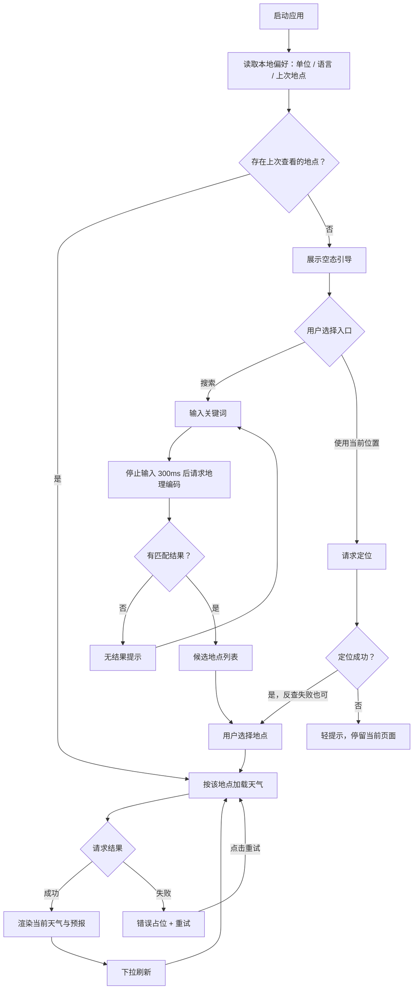

# 天气应用（云舒）需求文档

> 版本：v1.0 | 日期：2026-10-28 | 平台：Mobile（Flutter） | 文档模式：敏捷（Epic → User Story → 验收标准）  
> 说明：本文档定义产品的对外行为与工程质量要求。第 7 章为数据来源与契约，供开发与维护参考。

---

## 1. 需求概述

### 1.1 产品说明

云舒是一个移动端天气应用：用户搜索地点或使用当前位置，查看该地点的当前天气与未来 7 天预报，并可展开单日详情。应用完整处理加载、错误、空态与无结果四种情形，支持简体中文、繁体中文与英文三种界面语言，以及公制 / 英制单位切换。

### 1.2 目标

- **用户目标**
  - 三次交互内（输入 → 选择 → 查看）拿到目标地点的当前天气；
  - 一眼看懂当前状况：温度、天气现象、体感、湿度、风速风向、气压、降水、紫外线；
  - 获得未来一周的趋势判断：最高 / 最低温、天气现象、降水概率；
  - 在信号不稳定时得到明确反馈与可恢复路径，而不是白屏或崩溃。
- **产品目标**
  - 免账号、免 API Key，安装即用；
  - 中文、繁体中文、英文用户都能用自己的语言使用；
  - 同一地点在 10 分钟内重复查看不产生重复网络请求。

### 1.3 范围

**包含**

- 地点搜索：关键词 → 候选列表 → 选择；中英文关键词均可用；支持中文译名（如「纽约」「伦敦」）
- 使用当前位置（可选授权，拒绝后不影响搜索）
- 当前天气、24 小时逐小时预报、24 小时温度趋势图、未来 7 天预报、单日详情
- 加载态、错误态、空态、无结果态的完整呈现与重试
- 单位制切换（°C / °F）与最近搜索记录
- 界面语言切换（简体 / 繁體 / English）与桌面显示名本地化
- 分层架构、统一错误模型、关键路径自动化测试
- README（架构说明、运行方式、取舍说明）

**不包含**

- 用户账号、登录注册、服务端与数据库
- 多城市收藏夹管理（仅保留轻量「最近搜索」）
- 天气地图、雷达图、推送通知、桌面小组件
- 天气数据持久化（天气时效性短，仅提供 10 分钟内存缓存）
- 自建后端代理（直接调用公开 API）
- 搜索结果的名称多语言化（仅界面文案支持多语言）
- 后台定位与位置更新提醒（仅在用户点击时取一次位置）

### 1.4 术语表

| 术语 | 定义 |
|------|------|
| 地点 | 地理编码结果：经纬度、名称、行政区、国家、时区 |
| 当前天气 | 目标地点此刻的观测值 |
| 预报 | 逐日预报与逐小时预报 |
| 地理编码 | 文本关键词 → 候选地点的过程 |
| 逆地理编码 | 经纬度 → 地名，用于「使用当前位置」 |
| 中文译名别名 | 「纽约」这类中文译名与本地正式名不同形的城市映射：译名 → 本地名 + 国家码 |
| 双源地理编码 | 按关键词是否含中日韩字符选择首选地理编码源，另一源兜底 |
| 单位制 | 公制（°C / km/h / mm）或英制（°F / mph / inch） |
| 状态机 | 页面状态互斥，任一时刻只有一个成立 |
| 领域错误 | 统一错误类型，承载分类、用户文案与可重试性 |
| DTO / Entity | 接口传输对象 / 领域实体；传输对象只在数据层，经映射转为实体 |
| 防抖 | 输入停止 300ms 后才发起请求 |
| 数据新鲜度 | 缓存被视为可用的时长，默认 10 分钟 |
| WMO 代码 | 世界气象组织的天气现象代码（0–99），以数字返回 |
| 天气分组 | 晴 / 多云 / 雨 / 雪 / 雷暴 / 雾，用于选择图标动效与卡片渐变 |

---

## 2. 用户角色

### 2.1 角色

| 角色     | 描述                       | 核心诉求               |
| ------ | ------------------------ | ------------------ |
| 天气查询用户 | 移动端普通用户，匿名使用，无账号；定位为可选授权 | 快速找到地点、看懂当前天气与未来趋势 |

### 2.2 典型场景

- 出行前查询目的地天气，决定衣物与是否带伞。
- 查看本地未来几天的温度与降水趋势。
- 查询跨时区城市（如纽约、东京）的天气，日期与时刻以**地点当地时间**为准。
- 在中文界面搜索「纽约」，或在英文界面搜索 `New York`，都能得到正确城市。
- 网络不稳定时，看到可读的失败原因并一键重试，而不是整页白屏。

---

## 3. 业务流程

### 3.1 主流程

### 3.2 流程说明

1. **启动（A→B）**：同步读取本地偏好（单位制、界面语言、上次查看地点），不发起定位、不发起网络请求。
2. **优先恢复上次地点（C）**：有上次地点时直接进入加载流程，不显示空态；没有才展示空态引导。
3. **搜索（J→K）**：关键词去除首尾空格后长度不足 2 时不发请求，仅提示「请输入至少 2 个字符」；否则停止输入 300ms 后发起一次请求，期间新的输入会取消上一次请求。
4. **数据源选择**：关键词含中日韩字符时以 Photon 为首选源，否则以 Open-Meteo 为首选源；首选源返回空或失败时用另一源兜底；用户主动取消不触发兜底。
5. **结果判定（L）**：有结果渲染候选列表（最多 10 条）；返回空数组渲染无结果态（不是错误态）；请求失败在搜索区域内联展示错误与重试。
6. **选择地点（O）**：写入唯一选中地点并持久化为「上次地点」，关闭搜索面板，天气数据自动加载。
7. **使用当前位置（P→Q）**：定位精度取低精度（城市级），超时 12 秒；成功后将坐标反查为地名，反查失败用「当前位置」兜底；权限拒绝、系统定位关闭、超时均以轻提示反馈，不阻塞搜索。
8. **加载与渲染（D→F）**：当前天气、逐小时、逐日由同一次请求返回；加载中展示骨架屏（延迟 200ms 显示），成功渲染内容，失败展示错误占位。
9. **刷新（S）**：下拉手势强制穿透缓存重新请求，失败只提示不覆盖内容。

### 3.3 异常流程

| 异常场景   | 触发条件                     | 处理方式                                | 提示文案                         |
| ------ | ------------------------ | ----------------------------------- | ---------------------------- |
| 无网络    | 设备离线 / DNS 失败 / 连接被拒     | 错误态，可重试                             | 「网络连接不可用，请检查网络后重试」           |
| 请求超时   | 连接 / 发送 / 接收超过 10s       | 自动重试 1 次，仍失败展示错误态                   | 「请求超时，请稍后重试」                 |
| 服务端错误  | HTTP 5xx                 | 自动重试 2 次（500ms / 1000ms），仍失败展示错误态   | 「天气服务暂时不可用，请稍后再试」            |
| 触发限流   | HTTP 429                 | 遵循 `Retry-After`（上限 5s）重试 1 次，仍失败提示 | 「查询过于频繁，请稍后再试」               |
| 请求参数错误 | 其余 4xx                   | 不重试，直接错误态                           | 「请求参数有误，请稍后重试」               |
| 地点无数据  | HTTP 404                 | 不重试                                 | 「该地点暂无天气数据」                  |
| 数据解析失败 | 接口返回结构变化 / 必填字段缺失或类型不符  | 不重试，记录日志，展示错误态                      | 「数据解析异常，请稍后重试」               |
| 搜索无结果  | 地理编码成功但数组为空              | 无结果态，不视为错误，无重试按钮                    | 「未找到「{关键词}」相关地点，换个关键词试试」 |
| 输入过短   | 去除首尾空格后不足 2 字符        | 不发请求，内联提示                           | 「请输入至少 2 个字符」                |
| 请求取消   | 输入变更导致上一请求作废             | 静默取消，不展示错误、不触发兜底源                   | 无                            |
| 定位被拒绝  | 用户拒绝授权                   | 轻提示，页面停留原处                 | 「未获得定位权限，可手动搜索城市」            |
| 定位永久拒绝 | 系统记录为永久拒绝                | 轻提示 + 「去设置」跳转系统设置            | 「定位权限已被拒绝，请在系统设置中开启，或直接搜索城市」 |
| 定位不可用  | 系统定位关闭 / 硬件不可用 / 超时      | 轻提示，页面停留原处                  | 「暂时无法获取当前位置，请手动搜索城市」         |
| 反查地名失败 | 坐标反查失败或返回空 | 不视为错误，以「当前位置」为名称继续加载天气              | 无                            |

---

## 4. Epic 与 User Story

### 4.1 Epic 1：搜索地点

#### Story 1.1：关键词搜索地点（防抖与请求取消）

- **用户故事**：作为天气查询用户，我输入地点名称后自动获得候选列表，不必手动提交。
- **优先级**：P0
- **验收标准**
  - 停止输入 300ms 后才发起地理编码请求；持续输入期间不产生中间请求。
  - 关键词去除首尾空格后长度为 1 时不发起任何请求，并显示「请输入至少 2 个字符」。
  - 新请求发起时取消上一请求，取消不产生错误态、不展示提示、不触发备用数据源。
  - 输入有效关键词后，搜索区域立即显示加载指示器（含 300ms 防抖等待期），页面其余部分保持可交互。
  - 查询使用去除首尾空格后的字符串。
  - 搜索失败在搜索区域内联显示错误文案与重试按钮，不覆盖整页。
  - 含中日韩字符的关键词以 Photon 为首选源，其余以 Open-Meteo 为首选源；首选源返回空或失败时自动使用另一源。

#### Story 1.2：展示候选地点并选择

- **用户故事**：作为天气查询用户，我希望候选列表带有完整行政区划，以便区分同名地点。
- **优先级**：P0
- **验收标准**
  - 最多展示 10 条，每条展示「名称 + 一级行政区 + 国家」；行政区或国家缺失时省略对应部分。
  - 副标题与主名相同时省略副标题，不出现「臺北市 · 臺北市」。
  - Photon 结果按 OSM 地点类型权重排序（city / state / country > county > district / locality > 其他 > street > house），再截断到 10 条，避免「台北车站」排在「臺北市」之前。
  - 点击条目后：该地点成为当前选中地点并持久化，搜索面板关闭，立即进入天气加载流程，同时写入最近搜索。
  - 列表可滚动；条目高度一致。
  - 同一地点、同一单位在 10 分钟内被再次选择时复用内存缓存，不发起网络请求。

#### Story 1.3：无结果提示

- **用户故事**：作为天气查询用户，我希望无匹配时明确知道是「没找到」而不是「出错了」。
- **优先级**：P1
- **验收标准**
  - 地理编码成功返回空数组时展示无结果态，文案包含用户输入的关键词。
  - 无结果态不展示「重试」按钮。
  - 用户继续修改关键词后，无结果态自动清除并重新进入搜索流程。
  - 无结果态与错误态在状态模型（`SearchEmpty` / `SearchError`）与 UI 上严格区分。

#### Story 1.4：最近搜索记录

- **用户故事**：作为天气查询用户，我希望看到最近查过的地点，以便一键重新查看。
- **优先级**：P2
- **验收标准**
  - 成功选择地点后写入最近搜索；最多保留 5 条，按最近使用顺序排列，重复地点上移而不重复。
  - 搜索面板为空闲态（无输入）时展示最近搜索列表；点击任一记录直接加载该地点天气。
  - 点击记录右侧删除图标立即移除该条（不再二次确认），并同步写入本地存储。
  - 应用完全重启后记录仍在。

#### Story 1.5：使用当前位置

- **用户故事**：作为天气查询用户，我希望不输入文字也能快速查看本地天气。
- **优先级**：P2
- **验收标准**
  - 空态提供「使用当前位置」入口；搜索面板内始终保留一行「使用当前位置」，即使在结果态。
  - 定位进行中按钮显示加载指示与「定位中…」，不可重复触发。
  - 定位成功后反查地名并写入选中地点，搜索面板关闭，天气自动加载。
  - 反查地名失败不视为错误：以「当前位置」为名称、携带真实经纬度继续加载天气。
  - 用户拒绝授权或系统定位关闭 / 超时时，以轻提示说明可手动搜索，页面停留在原处，不弹出阻断式对话框。
  - 永久拒绝时轻提示附带「去设置」按钮，可跳转系统应用设置。
  - 定位精度为低精度（城市级），超时 12 秒。
  - 启动时不自动定位：只在用户显式点击时取一次位置。

#### Story 1.6：中文译名搜索

- **用户故事**：作为中文用户，我希望搜索「纽约」「伦敦」这类译名也能命中正确城市。
- **优先级**：P2
- **验收标准**
  - 命中别名表中的中文译名时，先用本地正式名 + 国家码查询拉丁源，只保留「名称与正式名一致且国家码一致」的结果。
  - 同名异国城市被正确排除（如 `London` 不落到加拿大安大略省）。
  - 别名桥接失败不阻断搜索：继续按原始关键词走双源流程。
  - 表外关键词不经过别名，行为与 Story 1.1 完全一致。
  - 别名命中的结果显示本地名称（如 `New York`），与其它条目的中文名可能不一致（名称与字形的一致性不在本次范围）。

---

### 4.2 Epic 2：查看当前天气

#### Story 2.1：展示当前天气核心指标

- **用户故事**：作为天气查询用户，我希望在一个区域内看到当前温度、天气现象与关键体感指标。
- **优先级**：P0
- **验收标准**
  - 卡片展示：地点名称（「当前位置」按当前语言渲染）、「行政区 · 国家」副标题（缺失则省略）、观测时间「更新于 HH:mm」（地点本地时区）、当前温度、天气现象文案、体感温度。
  - 指标区展示：湿度、风向 + 风速、降水量、气压、紫外线指数。
  - 紫外线取自当日预报的峰值。
  - 任一可选字段缺失时，该指标整体隐藏，不显示 `--` 或空占位。
  - 温度为整数时不显示小数位，非整数保留 1 位小数；0 与负值正常显示符号。
  - 指标区自动换行，放大字号至 1.6 倍时不溢出、不裁切。
  - 卡片背景按天气分组与昼夜选择渐变（白天 / 夜间 / 降水三组）。

#### Story 2.2：天气图标与文案映射

- **用户故事**：作为天气查询用户，我希望图标与描述直观易懂。
- **优先级**：P1
- **验收标准**
  - WMO 代码映射为图标 + 三语文案（如 0 → 晴 / Clear、61 → 小雨 / Light rain）。
  - 未定义的代码使用「未知」文案与问号图标，不抛异常。
  - 白天 / 夜间使用不同图标变体；逐小时数据不含昼夜标识，按 6:00–18:00 近似判断。
  - 图标带轻量动画（晴/夜间漂浮、雨雪粒子），系统开启「减弱动态效果」时退化为静态图标。
  - 映射规则集中定义，组件不直接判断天气代码含义。

#### Story 2.3：单位制切换

- **用户故事**：作为天气查询用户，我希望在公制与英制之间切换，并使用习惯的计量单位。
- **优先级**：P2
- **验收标准**
  - 切换后温度以 °F、风速以 mph、降水以 inch 展示；切回公制恢复 °C / km/h / mm。
  - 切换瞬间先将当前画面数值本地换算并更新后缀，同时后台按新单位重新请求，避免「点了没反应」。
  - 新数据返回前，页面内容保持在原位，不闪回骨架屏。
  - 缓存键为 `(纬度, 经度, 单位制)`，切换单位不会命中旧单位数据。
  - 新单位请求失败时保留已换算的内容，不进入错误态。
  - 单位偏好持久化，应用重启后沿用。

---

### 4.3 Epic 3：查看天气预报

#### Story 3.1：未来多日预报

- **用户故事**：作为天气查询用户，我希望看到未来 7 天的逐日预报，以便安排出行与穿衣。
- **优先级**：P0
- **验收标准**
  - 展示 7 个日期条目，从今天起算（直接使用 API 返回顺序，`daily[0]` 即今天），不依赖设备时钟推导日期。
  - 每行展示：今天 / 明天 / 星期 + 月日、天气图标、降水概率、最低温、最高温。
  - 使用相对温度区间条表现当日温度在整周极值区间中的位置；等温数据不崩溃、不贴边。
  - 列表为纵向排列，行高一致，点击任意行打开当日详情。
  - 预报日期基于地点本地时区，跨时区查询不出现日期偏移。

#### Story 3.2：逐小时预报

- **用户故事**：作为天气查询用户，我希望看到今天未来 24 小时的变化，以便判断几点会下雨。
- **优先级**：P1
- **验收标准**
  - 展示从当前观测小时起的 24 个时间点，横向滚动，每项含时刻、图标、温度、降水概率。
  - 首个条目即当前小时，无需手动滚动定位。
  - 降水概率缺失时不显示该行内容，其他字段照常展示。
  - 逐小时数据与当前天气、逐日预报由同一次请求返回，不额外发起请求。
  - 逐小时卡片高度对齐，随系统字号自适应，不溢出。

#### Story 3.3：预报日详情

- **用户故事**：作为天气查询用户，我希望点击某一天查看当天的细节。
- **优先级**：P2
- **验收标准**
  - 点击某日弹出底部面板，展示：日期与月日、天气图标与文案、温度区间、降水概率、日出时间、日落时间、最大风速、紫外线峰值。
  - 字段缺失时对应行整体隐藏，不显示占位符。
  - 全部明细字段缺失时显示「暂无更多数据」，而不是空白面板。
  - 面板可通过下滑或点击遮罩关闭；不跳转新页面，保持原页面状态。

#### Story 3.4：24 小时温度趋势图

- **用户故事**：作为天气查询用户，我希望一眼看出未来一天的温度走势。
- **优先级**：P2
- **验收标准**
  - 以曲线展示 24 小时温度走势，并标注最低 / 最高温及其出现时间。
  - 数据点少于 2 个时整块隐藏（单点无法构成趋势）。
  - 横向滑动可实时选中最近的小时点，松手后保留选中；轻点某点同样选中。
  - 竖向滑动交给外层页面滚动，不产生选中残留。
  - 读屏可朗读温度极值摘要（含出现时间）。
  - 系统字号放大时画布随之增高，曲线区高度保持不变，标签不重叠。

---

### 4.4 Epic 4：加载、错误与空态

#### Story 4.1：加载态呈现

- **用户故事**：作为天气查询用户，我希望加载时有明确反馈与页面结构预览。
- **优先级**：P0
- **验收标准**
  - 首次为某地点加载时展示骨架屏，占位形状与真实布局一致。
  - 骨架屏延迟 200ms 展示：请求在 200ms 内完成则不出现骨架屏，避免闪烁。
  - 已有内容时下拉刷新展示局部刷新指示器，不回退到骨架屏。
  - 加载过程中切换地点：旧请求被取消，页面不出现错乱或崩溃。
  - 错误态点击重试后进入骨架屏流程。

#### Story 4.2：错误态与重试

- **用户故事**：作为天气查询用户，我希望失败时看到可读说明与重试按钮。
- **优先级**：P0
- **验收标准**
  - 展示错误图标 + 当前语言文案 + 「重试」按钮。
  - 仅当失败被判定为可重试（`canRetry`）时才显示重试按钮；解析失败等不可重试错误不显示按钮。
  - 点击重试以相同地点与单位重新加载。
  - 重试成功后切换为内容态，保留已选地点。
  - 错误态下切换其他地点，错误态被清除并进入新地点的加载流程。
  - 错误对象未携带业务文案时使用兜底文案「加载失败，请重试」；界面绝不展示异常堆栈或原始英文错误。

#### Story 4.3：错误分类与重试策略

- **用户故事**：作为天气查询用户，我希望不同类型的失败给出不同提示与恢复建议。
- **优先级**：P1
- **验收标准**
  - 失败被统一分类：网络不可用、超时、服务端错误、限流（429）、客户端错误（其余 4xx）、资源不存在（404）、解析失败、请求取消、未知，以及定位权限拒绝与定位不可用。
  - 自动重试集中在网络层：网络、超时、5xx 与 429 有有限次自动重试（429 遵循 `Retry-After`）；其余 4xx、解析失败与主动取消不重试。具体次数与退避见下表。
  - 界面层只消费领域错误类型，不出现网络库或平台异常类型的分支。
  - 非 release 构建输出结构化网络日志，release 构建不输出请求详情（详见 Story 5.7）。

**自动重试策略**

| 失败类型 | 自动重试次数 | 退避 | 用户可手动重试 |
|---------|------------|------|--------------|
| 网络 | 1 | 500ms | 是 |
| 超时 | 1 | 500ms | 是 |
| 服务端 5xx | 2 | 500ms / 1000ms | 是 |
| 限流 429 | 1 | `Retry-After`（上限 5s） | 是 |
| 其余 4xx | 0 | — | 否 |
| 解析失败 | 0 | — | 否 |
| 主动取消 | 0 | — | 否 |
| 未知 | 0 | — | 是 |

#### Story 4.4：下拉刷新

- **用户故事**：作为天气查询用户，我希望通过下拉手势获取最新数据。
- **优先级**：P1
- **验收标准**
  - 页面已有内容时下拉触发刷新并展示刷新指示器。
  - 刷新强制穿透缓存：即使距上次成功不足 10 分钟也重新请求（用户手势优先于新鲜度策略）。
  - 刷新成功后更新内容并写入缓存。
  - 刷新失败时收起指示器，用轻提示说明失败原因，**不**替换为全页错误态。

#### Story 4.5：空态引导

- **用户故事**：作为首次使用的用户，我希望看到明确引导，知道如何开始。
- **优先级**：P1
- **验收标准**
  - 无选中地点时展示空态：图标 + 「搜索城市查看天气」+ 补充说明 + 「搜索地点」按钮 + 「使用当前位置」按钮。
  - 存在上次查看的地点时直接进入该地点的加载流程，不展示空态。
  - 空态不展示任何错误提示或加载指示器。
  - 空态、无结果态、错误态为三个独立组件与状态，互不混用。

---

### 4.5 Epic 5：工程架构与质量

#### Story 5.1：分层架构与应用骨架

- **用户故事**：作为维护者，我希望看到清晰的目录与单向依赖，能快速定位改动点。
- **优先级**：P0
- **验收标准**
  - 源码分为跨功能基础设施与按功能组织的业务模块，每个业务模块内部有数据、领域、界面三层。
  - 领域层不依赖界面框架、网络库、定位库与本地存储，也不出现序列化注解。
  - 依赖方向为界面 → 领域 ← 数据，无反向依赖。
  - 跨功能共享的实体与单位制下沉到公共层，业务模块之间不互相依赖。
  - 所有依赖统一注入，组件内不直接创建数据访问对象。
  - `flutter analyze` 零问题；`dart format` 与既有格式无差异。

#### Story 5.2：数据层抽象与 API 集成

- **用户故事**：作为维护者，我希望数据访问被接口抽象、DTO 与实体分离，替换数据源时改动可控。
- **优先级**：P0
- **验收标准**
  - 领域层定义数据访问接口，返回领域实体或抛出领域错误，签名中不出现 HTTP 客户端概念；取消能力由与框架无关的令牌表达。
  - 数据传输对象负责解析，实体不含解析逻辑，两者之间有显式映射。
  - 网络客户端集中创建，超时统一为 10 秒，日志与重试分层挂载。
  - 异常在数据源层统一映射为领域错误，仓储层不重复捕获。
  - 接口字段缺失或类型不符时呈现为可读的错误态，不崩溃。
  - 请求可取消，取消不产生错误提示。
  - 替换供应商只需新增数据源实现并调整一处装配，领域层与界面层零改动。

#### Story 5.3：统一错误模型

- **用户故事**：作为维护者，我希望错误类型与映射规则集中定义，错误处理不是散落的临时补丁。
- **优先级**：P1
- **验收标准**
  - 错误类型集中定义，覆盖网络、超时、服务端、限流、客户端、资源不存在、解析、取消、未知，以及定位权限与定位不可用。
  - 每个错误类型提供中文兜底文案、是否可重试与稳定类型标识；同时保留原始异常与状态码供日志使用。
  - 界面按当前语言取文案，不直接展示中文兜底。
  - 数据源异常统一转换为对应错误类型；已是领域错误时原样返回。
  - 单元测试覆盖每种 HTTP 状态与异常类型到错误类型的映射，以及可重试判定。

#### Story 5.4：自动化测试

- **用户故事**：作为维护者，我希望关键路径有测试覆盖，能安全重构。
- **优先级**：P1
- **验收标准**
  - `fvm flutter test` 全部通过，全程不触网、不需要真机。
  - 测试目录与源码结构对应。
  - 覆盖范围：
    - 错误映射（各状态码 / 超时 / 取消 / 解析异常）、自动重试行为、日志内容与敏感信息打码、主题状态栏样式、三语文案一致性；
    - 接口响应解析（真实响应形状、缺字段判定为解析失败、空降水概率保持为空）、映射与单位换算（双向可逆）；
    - 领域用例规则（无逐日预报判定为不完整）、状态机各次转换（自动加载 / 单位切换重请求 / 缓存命中 / 刷新 / 错误）；
    - 界面四种状态的渲染、空态双入口、当日详情字段隐藏规则、趋势图布局与手势；
    - 搜索防抖、最短长度、首尾空格处理、无结果态与错误态区分、请求取消；逆地理编码层级选择（多组真实响应样本）；双源兜底与中文别名桥接；定位链路（含权限失败不发起反查）。

#### Story 5.5：配置与密钥

- **用户故事**：作为使用者，我希望克隆代码后无需申请任何密钥即可运行。
- **优先级**：P1
- **验收标准**
  - 所选三个公开服务（Open-Meteo 天气、Open-Meteo 地理编码、Photon）均免 Key，`pub get` 后可直接运行。
  - 仓库内不存在任何硬编码密钥或 `.env` 文件。
  - 所有可调参数集中在单一配置入口：服务地址、超时、重试与防抖、搜索结果上限、预报天数、逐小时条数、缓存时长、定位超时、骨架屏延迟、User-Agent。

#### Story 5.6：主题与设计 token

- **用户故事**：作为用户，我希望界面视觉一致，并跟随系统深色模式。
- **优先级**：P2
- **验收标准**
  - 主题 token 集中定义：间距与圆角阶梯、最小触控尺寸、品牌种子色、白天 / 夜间 / 降水三组卡片渐变。
  - 亮色与暗色主题由同一品牌种子色生成，仅亮度不同。
  - 系统切换深色模式时自动切换，天气内容不丢失。
  - 透明顶栏下的状态栏 / 导航栏图标颜色按主题亮度显式指定（避免浅色主题出现白底白字）。
  - 可点击元素（按钮、列表删除图标）触摸目标不小于 44×44dp。

#### Story 5.7：日志与可观测性

- **用户故事**：作为维护者，我希望日志有节制、可追溯，且不泄露请求内容。
- **优先级**：P3
- **验收标准**
  - 非 release 构建按「一个请求一块」输出：请求地址与方法、请求体、状态码与耗时、响应体；超长内容截断。
  - 各类身份凭证类请求头一律打码输出。
  - 失败请求额外输出错误类型与状态码。
  - release 构建不输出任何请求详情。
  - 不引入第三方 APM。

---

### 4.6 Epic 6：多语言与本地化

#### Story 6.1：应用内语言切换

- **用户故事**：作为不同语言的用户，我希望应用以自己的语言显示。
- **优先级**：P1
- **验收标准**
  - 支持简体中文、繁体中文、English 三种界面语言；默认跟随系统。
  - 顶栏语言菜单提供「跟随系统 / 简体中文 / 繁體中文 / English」四项，选择后立即生效，无需重启。
  - 显式选择持久化；选择「跟随系统」清除该记录。
  - 系统语言解析规则：`zh` + script/地区为 `Hant`、`TW`、`HK`、`MO` 时用繁体，其余中文用简体；`en` 用英文；不支持的语言回退简体中文。
  - 文案集中管理，组件按当前语言取值，不在组件内写死文案。
  - 日期、星期、风向、温度趋势读屏摘要、错误文案均随语言切换。
  - 搜索结果显示的地理名称语言不受界面语言控制（名称本地化不在本次范围）。

#### Story 6.2：桌面显示名本地化

- **用户故事**：作为用户，我希望桌面图标名称是我能读懂的应用名。
- **优先级**：P3
- **验收标准**
  - 应用名：简体「云舒」、繁体「雲舒」、其他语言「Cirrus」。
  - Android 通过本地化资源提供应用名，iOS 通过本地化 plist 覆盖显示名；平台默认值作为非中文系统的基线。
  - 桌面名跟随**系统**语言，与应用内语言设置相互独立。

---

### 4.7 Epic 7：交付物与规范

#### Story 7.1：README

- **用户故事**：作为使用者或维护者，我希望通过 README 快速了解如何运行、架构与关键取舍。
- **优先级**：P0
- **验收标准**
  - 包含章节：功能、技术栈与版本、快速开始（含 SDK 版本要求与平台权限）、项目结构、架构、状态管理、错误处理、设计取舍表、已知限制、测试、后续计划、许可证与数据署名。
  - 按快速开始执行可在 5 分钟内运行成功，无需任何密钥。
  - 取舍表至少覆盖 6 项核心决策：天气 API 选型、中文搜索方案、状态管理、缓存策略、错误处理与重试、国际化。
  - 明确列出已知限制与后续计划。

#### Story 7.2：代码规范与静态检查

- **用户故事**：作为维护者，我希望仓库自带一致的格式化与检查配置。
- **优先级**：P2
- **验收标准**
  - 静态检查在 Flutter 官方规则集之上追加严格规则：显式返回类型、禁止隐式 `dynamic` 与调试输出、偏好不可变声明与单引号、未等待的异步调用需显式标记，并开启严格类型转换与推断。
  - `flutter analyze` 零问题。
  - 代码格式检查无差异。
  - 当前版本不包含 CI 配置。

---

## 5. 非功能需求

### 5.1 性能目标

| 指标 | 目标 | 说明 |
|------|------|------|
| 冷启动到可交互 | < 2.5s | 中端 Android 机，release 模式，不含首屏网络请求 |
| 搜索结果呈现 | P95 < 1.5s | 含 300ms 防抖 |
| 天气首屏呈现 | P95 < 2.5s | 当前天气与预报一次请求返回 |
| 列表滚动 | ≥ 55fps | 预报与逐小时列表，中端机 release 模式 |
| 内存占用 | 峰值 < 150MB | 常规使用，切换地点 20 次不持续增长 |
| 重复请求抑制 | 10 分钟内同地点同单位不重复请求 | 内存缓存 + 新鲜度策略 |

### 5.2 安全要求

- 所有请求使用 HTTPS，不接受明文回退。
- 所选服务均免密钥；仓库不包含密钥。
- 不采集、不上传任何用户数据；定位仅在用户显式授权后使用，坐标仅用于天气查询，与地点名称一起作为「上次地点」保存在本地。
- release 构建不输出请求 URL 参数、响应体或标识信息。
- 代码混淆与证书绑定不在当前范围（公开只读 API，收益低于成本）。

### 5.3 可用性要求

- 无网络时展示明确错误态与重试入口，不崩溃、不白屏。
- 天气服务不可用时，应用仍可启动并正常搜索，仅天气区域展示错误态。
- 任何异常路径均映射为用户可读文案，不出现未捕获异常导致的错误页。
- 定位失败不阻塞搜索主流程。

### 5.4 兼容性要求

| 类型 | 要求 |
|------|------|
| 操作系统 | iOS 15+ / Android 7.0+（minSdk 24） |
| 屏幕尺寸 | 适配 375dp（iPhone SE）至 430dp（iPhone Pro Max），平板宽度下内容不溢出 |
| 字号缩放 | 支持 1.0x–1.6x，关键布局不溢出、不裁切 |
| 主题 | 跟随系统亮色 / 深色 |
| 屏幕方向 | 竖屏优先；横屏不崩溃、内容可滚动 |
| 无障碍 | 关键图标提供读屏标签与长按提示；触摸目标 ≥ 44×44dp |

---

## 6. 交互说明

### 6.1 页面结构

应用采用**单主页面 + 搜索面板 + 详情面板**结构，无页面跳转。

**首页**

- 顶栏：应用名（随界面语言）、语言菜单、单位切换（°C / °F）、搜索按钮。
- 当前天气卡片：地点名与「行政区 · 国家」、右上「更新于 HH:mm」、大字号温度、天气图标与文案、体感温度、指标区（湿度 / 风速风向 / 降水 / 气压 / 紫外线，自动换行）。
- 24 小时温度趋势图：曲线 + 最低 / 最高标记，可滑动选点。
- 逐小时预报：横向滚动卡片。
- 未来 7 天：纵向列表，含相对温度区间条，点击打开详情。
- 下拉刷新：顶部刷新指示器，失败仅做轻提示。

**搜索面板（底部弹出）**

- 结构：输入框（自动聚焦、可清空）→ 分隔线 → 「使用当前位置」行（常驻）→ 分隔线 → 内容区。
- 内容区随状态切换：最近搜索 / 加载中 / 候选列表 / 无结果 / 错误重试 / 输入过短提示。
- 选择地点或定位成功后自动关闭面板。

**详情面板（底部弹出）**

- 结构：日期与月日、天气图标、温度区间与天气文案、明细行（降水概率 / 日出 / 日落 / 最大风速 / 紫外线峰值）。
- 关闭方式：下滑或点击遮罩。

### 6.2 状态呈现映射

| 状态 | 触发条件 | 呈现 |
|------|---------|---------|
| 空态 | 无已选地点 | 图标 + 「搜索城市查看天气」+ 搜索入口 + 使用当前位置入口 |
| 加载中（首次） | 请求进行中且超过 200ms | 骨架屏 |
| 加载中（刷新） | 已有内容时下拉 | 内容保留 + 刷新指示器 |
| 成功 | 数据返回 | 完整内容 |
| 失败 | 请求失败 | 错误图标 + 当前语言文案 + 重试按钮（仅可重试时） |
| 搜索无结果 | 地理编码返回空数组 | 内联无结果提示，无重试按钮 |

---

## 7. 数据来源与契约

### 7.1 数据来源

| 服务 | 用途 | 鉴权 |
|------|------|------|
| Open-Meteo Geocoding | 关键词 → 候选地点（拉丁字母首选） | 无 |
| Open-Meteo Forecast | 当前天气 + 逐小时 + 逐日预报 | 无 |
| Photon（基于 OpenStreetMap） | 关键词 → 候选地点（CJK 首选、拉丁兜底）、坐标 → 地名 | 无（需 User-Agent） |

服务可替换：更换数据来源不影响界面与领域层（见 Story 5.2）。

### 7.2 关键请求约定

- 天气请求固定携带 `timezone=auto`，返回的时间均为地点本地时间，不按设备时区换算。
- 预报天数固定 7 天；逐小时取当前观测小时起的 24 条。
- 单位通过请求参数同步：温度 `celsius | fahrenheit`、风速 `kmh | mph`、降水 `mm | inch`。
- 地理编码结果语言目前固定为中文，不随界面语言切换。
- Photon 先取 3 倍结果，按地点类型权重排序后截断到 10 条。
- 中文别名桥接用本地正式名查询，并只保留「名称一致 + 国家码一致」的结果。

### 7.3 数据范围

| 实体 | 承载信息 |
|------|---------|
| 地点 | 名称、经纬度、一级行政区、国家、时区；「当前位置」使用固定标识 |
| 当前天气 | 观测时间、温度、体感、湿度、风速风向、天气代码与昼夜、气压、降水、紫外线（取自当日预报峰值） |
| 逐日预报 | 日期、天气代码、最高 / 最低温、降水概率、日出日落、最大风速、紫外线峰值 |
| 逐小时预报 | 时间点、温度、天气代码、降水概率 |
| 天气聚合 | 地点 + 单位制 + 当前天气 + 逐小时 + 逐日 |

可选字段缺失时整项隐藏，不展示占位符（见 Story 2.1、3.3）。

### 7.4 本地持久化

| 数据 | 说明 |
|------|------|
| 单位制偏好 | 公制或英制，默认公制 |
| 界面语言 | 三种语言；未设置表示跟随系统 |
| 上次查看地点 | 启动时用于直接恢复该地点的天气 |
| 最近搜索 | 最多 5 条，按最近使用排序 |

天气数据不落盘，仅内存缓存 10 分钟。

---

## 8. 验收清单

1. 输入关键词可搜索并选出地点；中文、英文、中文译名均可命中。
2. 展示当前天气：地点、观测时间、温度、现象、体感、湿度、风速风向、气压、降水、紫外线；缺失字段隐藏。
3. 展示未来 7 天预报与 24 小时逐小时预报；点击某日可查看详情。
4. 首次加载展示骨架屏（延迟 200ms），下拉刷新展示局部指示器且不覆盖内容。
5. 断网时展示错误态并可重试成功；刷新失败只做轻提示。
6. 搜索无匹配时展示「无结果」而非错误，且不提供重试按钮。
7. 首次启动无上次地点时展示空态引导，提供搜索与定位两个入口。
8. 切换 °C / °F 后温度、风速、降水单位同步变化，重启后保持。
9. 切换语言后界面文案立即生效；桌面显示名随系统语言变化。
10. 使用当前位置可加载本地天气；拒绝授权时给出非阻断提示。

工程与交付要求见 Epic 5 与 Epic 7，按对应验收标准执行。

---

## 9. 参考资料

- Open-Meteo Forecast API：https://open-meteo.com/en/docs
- Open-Meteo Geocoding API：https://open-meteo.com/en/docs/geocoding-api
- Photon（OSM 地理编码）：https://photon.komoot.io/
- WMO Weather interpretation codes：Open-Meteo 文档 `weather_code` 章节
- Flutter 官方架构指南：https://docs.flutter.dev/app-architecture
- Riverpod 文档：https://riverpod.dev
- Effective Dart：https://dart.dev/effective-dart
